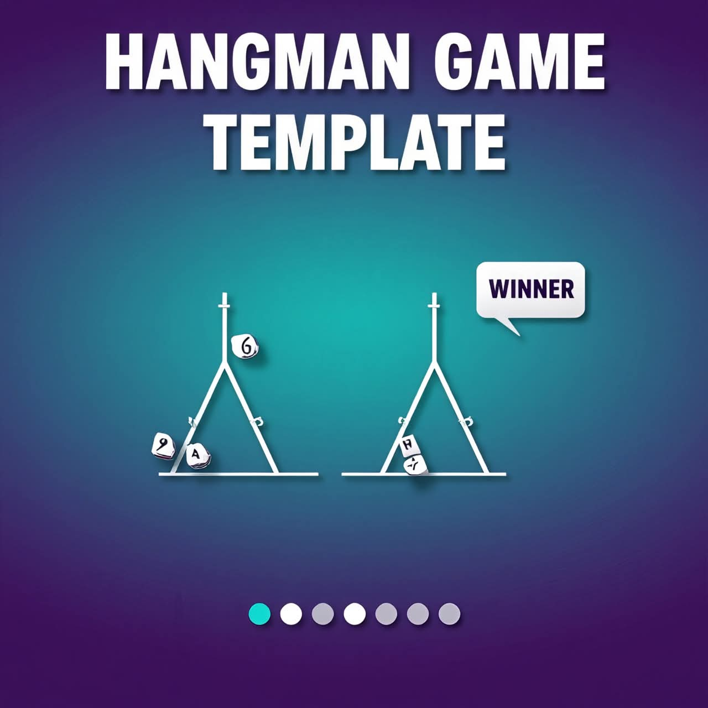

# Hangman Game - Interactive Word Game

لعبة Hangman تفاعلية كاملة مبنية بـ HTML, CSS, JavaScript فقط. 
بدون مكتبات خارجية ومتجاوبة 100% مع جميع الاجهزة.



### ✨ المميزات
- **4 تصنيفات**: Programming, People, Movies, Countries
- **نظام رسم تفاعلي**: 8 مراحل للرسم عند الخطأ
- **تصميم عصري**: Glass Effect + تدرج لوني + انيميشن
- **متجاوب بالكامل**: يعمل على الموبايل والتابلت والديسكتوب
- **اصوات**: صوت عند الاجابة الصحيحة والخاطئة
- **سهلة التعديل**: اضف كلماتك الخاصة خلال دقيقة
- **كود نظيف ومعلق**: جاهز للتسليم للزبون

### 🚀 طريقة التشغيل
1. فك الضغط عن الملفات
2. افتح `index.html` في المتصفح
3. ابدأ اللعب!

### 📝 كيفية اضافة كلمات جديدة
افتح ملف `main.js` وعدل كائن `words`:
```javascript
const words = {
  programming: ["javascript", "python", "java"],
  animals: ["cat", "dog", "lion"] // اضف تصنيف جديد هنا
};